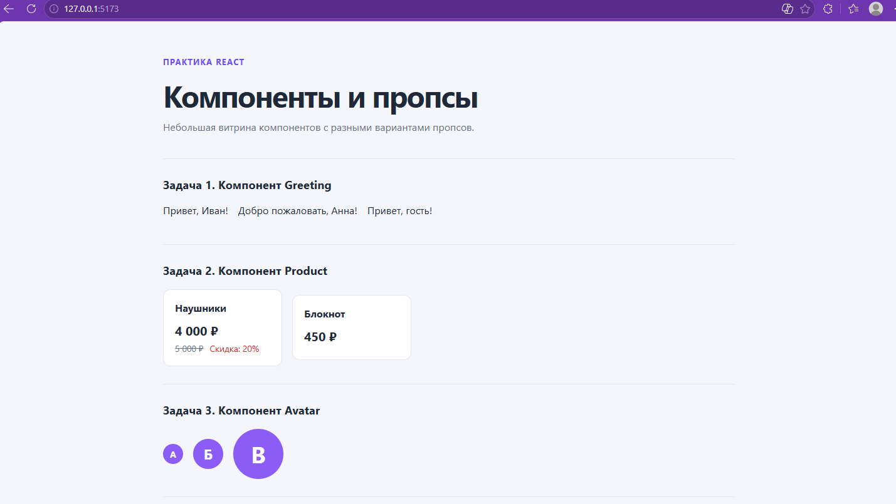
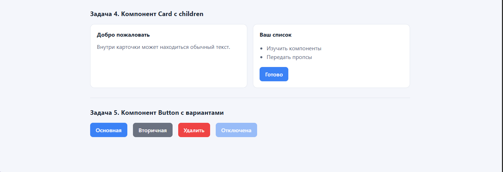

# Практика React: компоненты и пропсы

Учебный проект на React: пять компонентов с пропсами и примерами их использования.

## Стек

- React 18
- Vite 6
- CSS без UI-библиотек

## Структура

```text
practice/
└── practice_2/
    ├── screenshots/
    │   ├── components-greeting-product-avatar.png
    │   └── components-card-button.png
    ├── src/
    │   ├── components/
    │   │   ├── Greeting.jsx
    │   │   ├── Product.jsx
    │   │   ├── Avatar.jsx
    │   │   ├── Card.jsx
    │   │   └── Button.jsx
    │   ├── App.jsx
    │   ├── main.jsx
    │   └── styles.css
    ├── index.html
    ├── package.json
    └── README.md
```

## Запуск

Из каталога `practice/practice_2` выполните:

```bash
npm install
npm run dev
```

Production-сборка:

```bash
npm run build
```

## Задачи

1. **Greeting** — приветствие с именем, пользовательским текстом и fallback-именем «гость».
2. **Product** — цена с вычисленной скидкой и зачёркнутая исходная цена.
3. **Avatar** — круглый аватар с первой буквой имени; показаны размеры 32, 48 и 80 px.
4. **Card** — карточка с заголовком и произвольным содержимым через `children`.
5. **Button** — кнопки `primary`, `secondary`, `danger` и отключённое состояние.

## Скриншоты

### Greeting, Product и Avatar



### Card и Button


